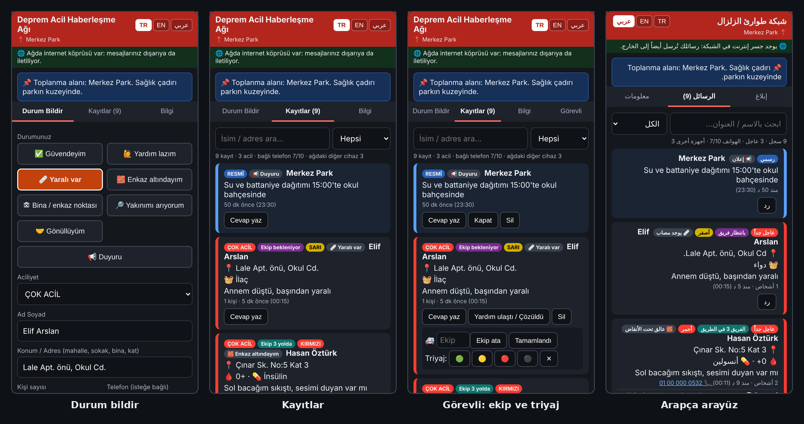
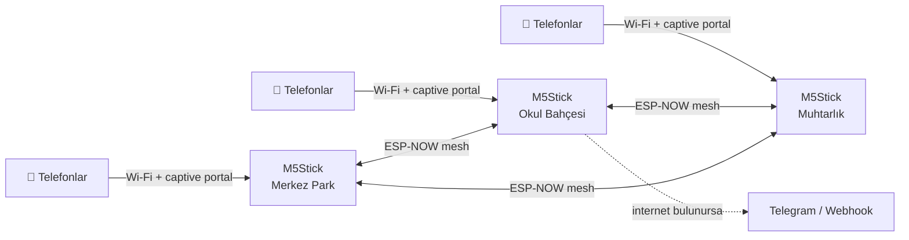
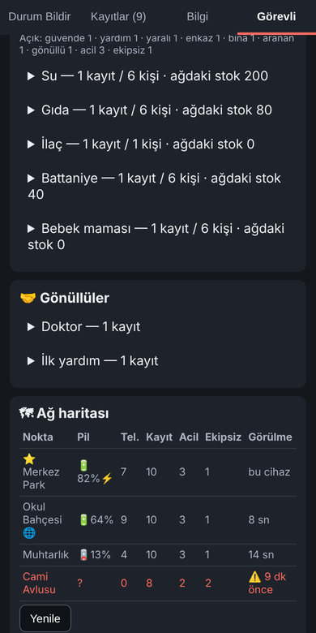
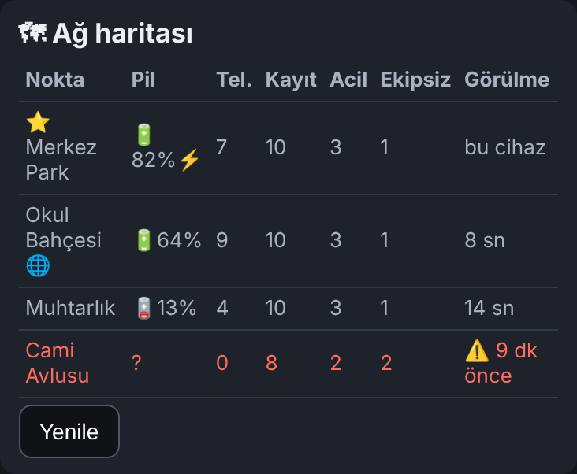

# ESP32 Earthquake Message System — Deprem Acil Haberleşme Ağı

> Baz istasyonları ve internet çöktüğünde devreye giren, ESP32 tabanlı açık Wi‑Fi acil durum haberleşme sistemi. Telefonlar **uygulama kurmadan** ağa bağlanır, durumunu ve aciliyetini bildirir; cihazlar mesajları birbirine aktararak mahalle ölçeğinde bir ağ oluşturur.
>
> *EN: An offline emergency communication system for earthquakes, built on the ESP32. Phones join an open Wi‑Fi network with a captive portal (no app needed) and report their status. Devices relay messages to each other to cover a whole neighbourhood.*



<sub>Görseller v2.1 web arayüzünün gerçek kodundan, örnek verilerle alınmıştır. Kişi ve adresler temsilidir.</sub>

## Nasıl çalışır?



1. Cihaz şifresiz `0000-DEPREM-ACIL-AG` ağını yayınlar. Ad sıfırlarla başladığı için Wi‑Fi listesinin en üstünde görünür.
2. Bağlanan telefonda acil durum sayfası kendiliğinden açılır (açılmazsa `192.168.4.1`).
3. Kişi durumunu bildirir: güvendeyim, yardım lazım, yaralı var, enkaz altındayım, yakınımı arıyorum, gönüllüyüm…
4. Kayıt ESP‑NOW ile yakındaki diğer cihazlara aktarılır; her cihaz bütün ağın kayıtlarını gösterir.
5. Ağdaki bir cihaz internet bulursa (telefon hotspot'u, Starlink vb.) tüm kayıtları dış dünyaya iletir.

## Sürümler

| Klasör | Donanım | Öne çıkanlar |
| --- | --- | --- |
| [`MGM_M5Stick_earthquake_system_v2.1`](MGM_M5Stick_earthquake_system_v2.1) | M5StickC Plus / Plus2 | **Güncel.** ESP‑NOW mesh, TR/EN/AR arayüz, görevli paneli, görev takibi ve triyaj, OTA, internet köprüsü |
| [`MGM_Esp32_earthquake_system_v1.1`](MGM_Esp32_earthquake_system_v1.1) | ESP32 + MPU6050 | Captive portal, konum paylaşımı, sistem istatistikleri, hassasiyet ayarı |
| [`MGM_Esp32_earthquake_system_v1`](MGM_Esp32_earthquake_system_v1) | ESP32 + MPU6050 | İlk sürüm: mesajlaşma, yardım talebi, yönetici paneli |

---

## v2.1 — M5Stick mesh ağı

### Halk için
- **Durum bildirimi:** aciliyet, kişi sayısı, adres (hazır adres listesinden seçilebilir), telefon, ihtiyaçlar (su, gıda, ilaç, çadır…)
- **Tıbbi bilgi:** kan grubu ve kritik ihtiyaç (insülin, diyaliz, oksijen, düzenli ilaç)
- **Bina / enkaz noktası:** hasar derecesi, "girmek yasak", "içeriden ses geliyor" (otomatik ÇOK ACİL)
- **Yakınımı arıyorum:** aranan isim "Güvendeyim" ve yardım kayıtlarıyla otomatik eşleşir; Türkçe karakter farkı sorun olmaz ("Ayse" = "Ayşe")
- **Gönüllü kaydı**, kayıtlara cevap yazma, arama ve filtreler, dağıtım noktaları ve stokları
- **Üç dil:** Türkçe, İngilizce ve Arapça (sağdan sola)

### Görevliler için (PIN ile)



- **Görev takibi:** yeni → ekip atandı → yolda → tamamlandı; aynı adrese iki ekip gitmez
- **START triyajı:** yeşil / sarı / kırmızı / siyah
- **İhtiyaç özeti:** hangi ihtiyaçtan kaç kişi var, ağdaki stokla yan yana
- **Ağ haritası:** her cihazın pili, bağlı telefon sayısı ve son görülme zamanı
- **İmzalı resmî duyurular** (HMAC‑SHA256, ortak ağ anahtarı)
- **Tüm ayarlar web'den:** Wi‑Fi, mesh, ekran ve ses, mesaj kuralları, pil tasarrufu, sarsıntı sensörü, internet köprüsü
- **Veri:** CSV dışa aktarma, yedek indirme ve geri yükleme
- **OTA:** iPhone/iPad'den `192.168.4.1/update` ile kablosuz güncelleme

<br clear="right">



### Cihazın kendisi
- Durum ekranı, açık yardım kayıtları listesi ve tek dokunuşla bağlanmak için **Wi‑Fi QR kodu**
- ÇOK ACİL kayıtta buzzer alarmı
- Dahili ivme sensörüyle **sarsıntı algılama** ve isteğe bağlı ağ bildirimi
- **Düşük pil uyarısı** tüm ağa yayınlanır

### Hızlı başlangıç
1. `releases/v2.1/DepremAcilAg_v2.1_TAM_kabloyla_0x0.bin` dosyasını kabloyla **0x0** adresine yazın:
   ```bash
   esptool.py --chip esp32 --baud 921600 write_flash 0x0 DepremAcilAg_v2.1_TAM_kabloyla_0x0.bin
   ```
2. Görevli PIN'i cihaz ekranında görünür. Telefonla `0000-DEPREM-ACIL-AG` ağına bağlanın.
3. Sonraki güncellemeler için `..._OTA_guncelleme.bin` dosyasını `192.168.4.1/update` sayfasından yükleyin.

Derleme, ayarlar ve sınırlar için: [v2.1 README](MGM_M5Stick_earthquake_system_v2.1/README.md)

---

## v1 / v1.1 — ESP32 + MPU6050


- **Deprem algılama:** MPU6050 ivme büyüklüğü eşiği (varsayılan 2.5 g) aşarsa uyarı verir; aynı sarsıntıda tekrarlamamak için 10 sn bekleme süresi vardır.
- **Kendi Wi‑Fi ağı:** `EarthquakeAlertSystem` (şifresiz, yönetici panelinden değiştirilebilir) ve captive portal.
- **Mesajlaşma ve yardım talepleri:** son 50 mesaj, son 20 yardım talebi ve 10 kullanıcı konumu saklanır.
- **Yönetici paneli** (`/admin`): sistem durumu, yeniden başlatma, acil durum modu, ağ adı ve hassasiyet ayarı, veri temizleme.

**Donanım:** ESP32 geliştirme kartı, MPU6050 (I²C, SDA = GPIO21, SCL = GPIO22), kart üzerindeki LED (GPIO2).

**Kurulum:** Arduino IDE'ye ESP32 desteğini ve `MPU6050`, `ArduinoJson` kütüphanelerini ekleyin. `.ino` dosyasını yükleyin, `data/` klasörünü LittleFS'e aktarın, sonra `EarthquakeAlertSystem` ağına bağlanın.

> **Güvenlik notu:** v1/v1.1'de yönetici kullanıcı adı ve şifresi kodda sabittir (`adminUsername`, `adminPassword`). Gerçek kullanımdan önce mutlaka değiştirin.

---

## Yol haritası

- **Mahalle istasyonu:** Raspberry Pi + dış ortam erişim noktası; yüzlerce kullanıcı ve çevrimdışı harita
- **Omurga:** istasyonlar arası 5 GHz noktadan noktaya bağlantı ve ESP32 noktalarıyla köprü
- **Yedek hat:** LoRa / Meshtastic

## Uyarı

Bu proje gönüllü bir prototiptir. Resmî bir erken uyarı veya acil çağrı sisteminin yerine geçmez. Ağ açıktır; yazılan her şeyi ağa bağlanan herkes görebilir.

## Lisans

MIT Lisansı. Ayrıntılar için [LICENSE](LICENSE) dosyasına bakın.

— Mert Güzelmansur (MGM)
